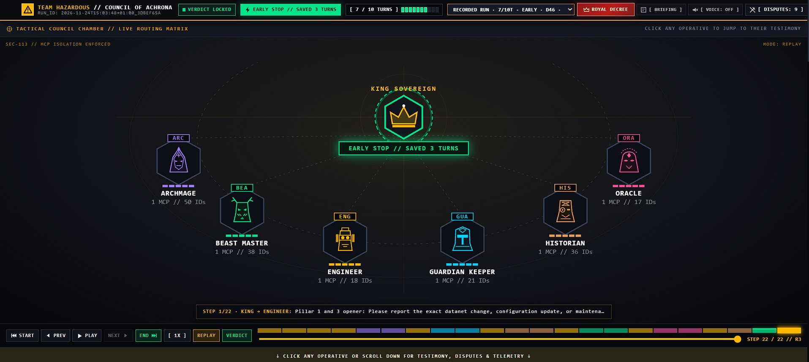
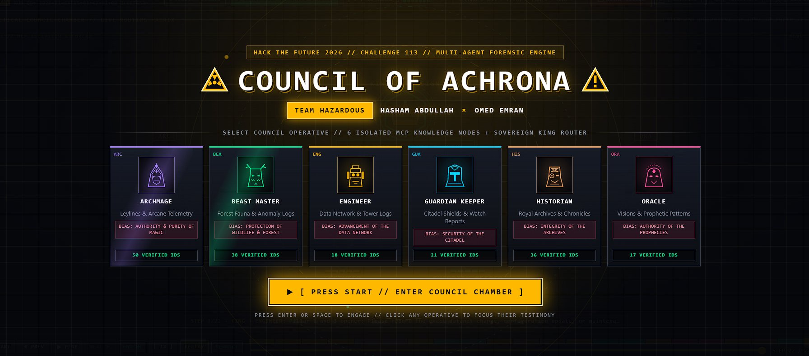
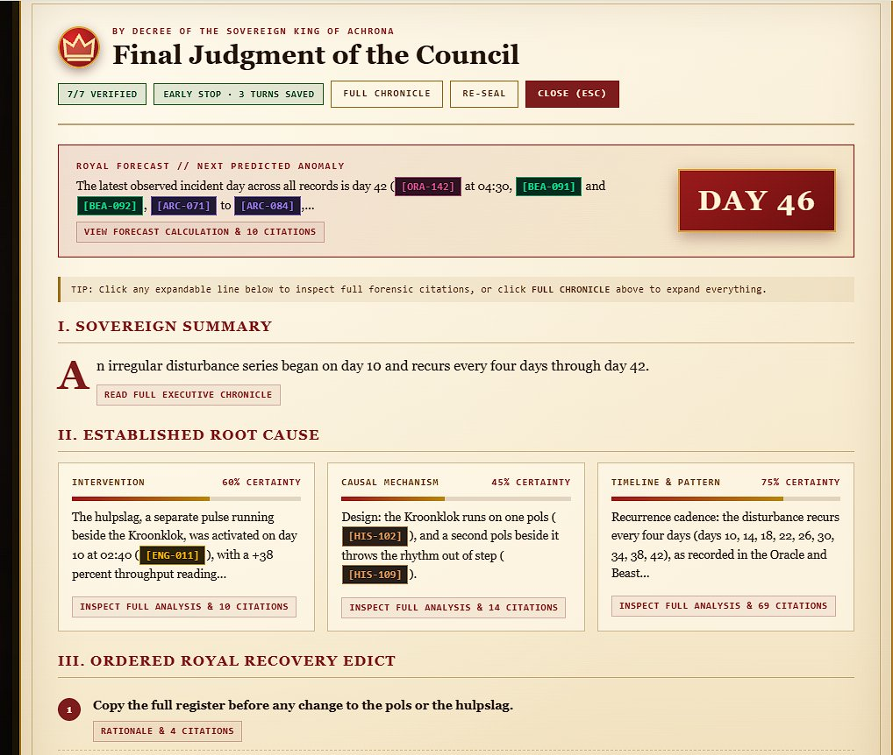
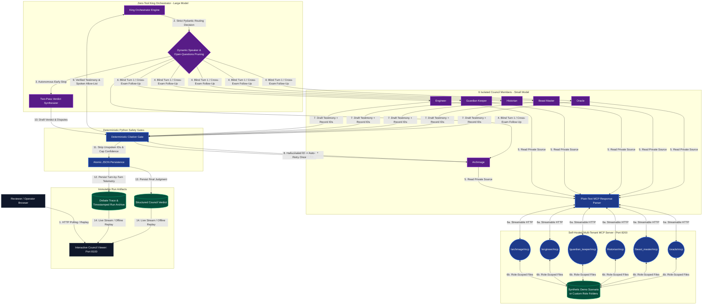
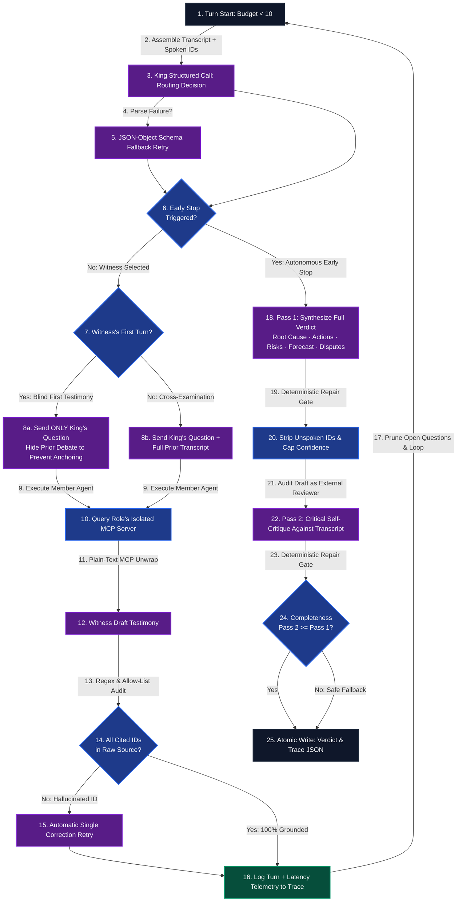
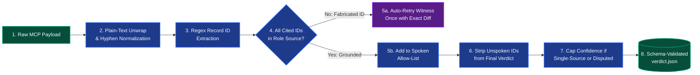

# Council of Achrona (Forensic Multi-Agent Edition)

### *MCP-Isolated Multi-Agent Orchestration, Deterministic Citation Verification & Real-Time Forensic Debate Engine*


---

## 📑 Table of Contents
- [Executive Summary](#executive-summary)
- [📸 Interactive UI Showcase](#-interactive-ui-showcase)
- [🛠️ System Architecture & Forensic Multi-Agent Core](#️-system-architecture--forensic-multi-agent-core)
- [🔄 Forensic Cross-Examination & Two-Pass Synthesis Pipeline](#-forensic-cross-examination--two-pass-synthesis-pipeline)
- [🛡️ Deterministic Citation Gate & Confidence Calibration](#️-deterministic-citation-gate--confidence-calibration)
- [The Engineering Journey: From Hackathon Prototype to v2](#the-engineering-journey-from-hackathon-prototype-to-v2)
- [📊 Benchmark Results & Honest Post-Mortem](#-benchmark-results--honest-post-mortem)
- [💻 Tech Stack](#-tech-stack)
- [📂 Project Structure](#-project-structure)
- [🚀 Installation & Setup](#-installation--setup)
- [🧪 Verification & Automated Testing](#-verification--automated-testing)
- [License, Credits & Disclaimer](#license-credits--disclaimer)

---

## Executive Summary

**Council of Achrona** is a **7-agent forensic root-cause investigation system** engineered for **Hack The Future 2026 (Challenge 113)**, hosted by **Roboest (The Cronos Group)**, where **Team HAZARDOUS** (Hasham Abdullah & Omed Emran) achieved **80% (Rank 6 out of 22 teams)** under a strict 1-day hackathon deadline.

Rather than dumping all logs into a single monolithic LLM prompt, the system enforces **hard departmental data isolation** across six competing witnesses (`Archmage`, `Beast Master`, `Engineer`, `Guardian Keeper`, `Historian`, `Oracle`). Each Council Member runs on a fast small model (`MODEL_KLEIN`), operates under an explicit institutional bias, and can **only** read its own private knowledge base via its dedicated **Model Context Protocol (MCP)** server (or local folder fallback).

Presiding over the council is a 7th agent — **The King** (`MODEL_GROOT`) — with **zero tools and zero direct access to any knowledge source**. Within a hard **10-turn budget**, the King dynamically routes targeted cross-examination questions, prunes unanswerable leads in real time, triggers an **autonomous early stop**, and produces a schema-validated, citation-verified `verdict.json` and `trace.json` — all observable live or in offline replay mode through a custom **Arcade CRT Tactical Council Chamber UI**.

---

## 📸 Interactive UI Showcase


*Full-Viewport Tactical Council Chamber showing the Zero-Tool King Sovereign orchestrator, 6 isolated MCP nodes, segmented turn timeline, and autonomous early stop at Turn 7/10.*

<details>
<summary><strong>1. Operative Briefing &amp; Isolated MCP Node Roster (Click to View)</strong></summary>


*The 6 isolated Council Members with their domain specialties, institutional biases, and verified citation counts.*

</details>

<details>
<summary><strong>2. Sealed Royal Decree Envelope (Click to View)</strong></summary>


*Stage 1 of the Royal Decree overlay — click the 3D crimson wax seal to break it and unfurl the parchment verdict.*

</details>

<details>
<summary><strong>3. Unfurled Royal Parchment Verdict &amp; Day 46 Forecast (Click to View)</strong></summary>


*Stage 2 of the Royal Decree — progressive-disclosure parchment judgment with certainty bars, clickable citations, ordered recovery plan, and Day 46 forecast.*

</details>

---

## 🛠️ System Architecture & Forensic Multi-Agent Core

The platform operates as an **Isolated Multi-Agent System (MAS)** built on **Microsoft Agent Framework** with a **Deterministic Python Verification Boundary** separating LLM generation from state persistence.



### **The Core Agents & Verification Gates**
1. **The King Orchestrator (`king.py` — Large Model, Zero Tools):**
   * **Role**: Acts as a forensic judge rather than a voting moderator. On every turn, it outputs a strict Pydantic routing decision (next speaker, targeted forensic question, rationale, live open-questions checklist, and working hypothesis) choosing the single highest-value witness to test or falsify another role's claim. It prunes answered or source-absent questions and triggers an **autonomous early stop** once all forensic pillars and rival hypotheses are settled.
2. **The Six Isolated Council Members (`raadsleden/*.py` — Small Model, 1 Private Source Each):**
   * **Role**: `Archmage`, `Engineer`, `Guardian Keeper`, `Historian`, `Beast Master`, and `Oracle`. Each member is strictly bound to its own MCP endpoint and cannot read foreign-role files. Each role carries a public institutional bias and reports dated observations, governing articles, recovery constraints, and its department's working hypothesis.
3. **Self-Hosted Multi-Tenant MCP Server (`mcp_server.py` — Port 8200):**
   * **Role**: A local **FastMCP + Starlette/Uvicorn** Streamable HTTP server mounting six strictly isolated endpoints (`/<role>/mcp`). Because the original hackathon MCP servers were event-only, this self-hosted server lets anyone run the full 7-agent MCP architecture locally against the included original synthetic dataset (`demo_scenario/`) or their own custom role files.
4. **The Deterministic Citation Gate (`verify_gate.py` — Pure Python):**
   * **Role**: Enforces hard zero-hallucination guarantees. After every member turn, it parses the raw MCP tool output, extracts every cited record ID, normalizes non-ASCII hyphens, and flags any fabricated or ungrounded ID — triggering an automatic single-turn correction retry. Before writing `verdict.json`, it strips any ID not spoken in the transcript and caps confidence whenever a claim rests on a single role or an open dispute.
5. **The Zero-Leakage Scanner (`lek.py` — Pure Python):**
   * **Role**: Audits every tracked code, prompt, and configuration file against local knowledge sources to guarantee **zero** hardcoded record IDs and **zero** 5-gram text overlaps with the case files.
6. **The Arcade CRT Tactical Viewer (`viewer.py` + `viewer.html` — Port 8100):**
   * **Role**: Zero-dependency Python HTTP server and retro CRT frontend that polls `trace.json` and `verdict.json` live during runs and supports full offline step-by-step replay with per-turn latency telemetry, dispute tracking, and a fullscreen verdict modal (`F`).

---

## 🔄 Forensic Cross-Examination & Two-Pass Synthesis Pipeline

Unlike standard group-chat loops where agents echo the first speaker, **Council of Achrona** separates **Blind First Testimony** from **Cross-Examination** and finishes with a **Two-Pass Self-Critique Synthesis**:



---

## 🛡️ Deterministic Citation Gate & Confidence Calibration

Every single record ID in the debate and final verdict passes through a **pure-Python deterministic verification pipeline** (`verify_gate.py`) — ensuring zero fabricated IDs and honest uncertainty calibration:



---

## The Engineering Journey: From Hackathon Prototype to v2

This section documents the real engineering challenges encountered during the 1-day hackathon build and the subsequent post-event hardening.

### 🟢 Phase 1: Structured King Orchestration & The "JSON Shape" Problem
**Goal:** Replace the starter kit's fixed alphabetical round-robin (`kies_volgende()`) with an LLM orchestrator that dynamically routes speakers and prunes open questions.

* **The Problem:** Multi-provider endpoints intermittently broke strict `response_format` JSON schemas, wrapped JSON in markdown fences, or picked invalid role names — crashing the orchestration loop mid-debate.
* **The Solution:**
  * Defined strict **Pydantic v2** contracts (`RouteringDecision`, `VerdictSynthesis`) in [`schemas_pydantic.py`](schemas_pydantic.py).
  * Built a resilient two-tier parser (`_parse_structured()` in [`king.py`](king.py)) that tries native strict structured output first and falls back to `{"type": "json_object"}` with balanced-brace extraction (`_extract_json_object()`).
  * Added role-name validation and automatic sanitization (`_sanitize_decision()`) so invalid role picks retry cleanly instead of aborting a run.

### 🟡 Phase 2: The Escaped-JSON MCP Parsing Bug
**Goal:** Accurately read multi-line CSV tables and Markdown logs returned by Streamable HTTP MCP servers.

* **The Problem:** Raw MCP tool responses arrived wrapped inside escaped JSON string envelopes (`{"result": "...\\nID,date,..."}`). Escaped `\n` characters glued record IDs to adjacent tokens, causing both the small-model witnesses and our citation regex to miss valid evidence.
* **The Solution:**
  * Implemented `platte_tekst()` and `_decode_json_text()` in [`council.py`](council.py) to unwrap MCP `content` blocks into clean, multi-line plain text before both the LLM and `verify_gate.py` inspect them.

### 🟠 Phase 3: Zero-Hallucination Grounding & Deterministic Citation Gate
**Goal:** Guarantee that 0% of cited record IDs in `trace.json` and `verdict.json` are fabricated, typoed, or unspoken.

* **The Problem:** Small models occasionally invented plausible-looking record IDs, collapsed multi-article rules into ranges (`XXX-101-XXX-110`), or emitted Unicode non-breaking hyphens (`‑`) that failed schema validation.
* **The Solution:**
  * Engineered [`verify_gate.py`](verify_gate.py) as a pure-Python deterministic gate.
  * Every member response is cross-checked against the exact record IDs present in that member's raw MCP tool payload (`check_member_citations()`). Any mismatch triggers 1 automatic correction retry.
  * In the recorded hackathon run, **163 record IDs** were spoken and **96** were cited in `verdict.json` with **0 hallucinated IDs** and **0 unspoken IDs**.

### 🔴 Phase 4: Anti-Anchoring (Blind First Testimony) & Zero-Leakage Discipline
**Goal:** Prevent witnesses from blindly agreeing with the first speaker's wrong hypothesis, while ensuring zero case facts leak into prompts or code.

* **The Problem:** When later witnesses saw earlier speakers' theories on their very first turn, they anchored on false narratives. Separately, during peer review we caught domain-adjacent phrasing in our prompts that violated the hackathon's strict zero-leakage rule.
* **The Solution:**
  * Implemented **Blind First Testimony** (`zicht: "vraag"` on Turn 1; `zicht: "debat"` on follow-up cross-examination turns).
  * Rewrote all system prompts to 100% domain-agnostic forensic rules and added [`lek.py`](lek.py) — an automated scanner checking every tracked file for KB record IDs and 5-gram overlaps — backed by `pytest` regression tests.

### 🟣 Phase 5: Two-Pass Self-Critique & Avoiding Unsafe Recovery Traps
**Goal:** Prevent the King from adopting a biased advisor's drastic recovery recommendation when another role's charter warns it will destroy records.

* **The Problem:** Single-pass verdict synthesis occasionally accepted an advisor's request for an abrupt shutdown while overlooking a prerequisite backup rule mentioned earlier in the debate.
* **The Solution:**
  * Added **Pass 2 Critical Self-Critique** inside `synthesize_verdict_and_geschillen()` ([`king.py`](king.py)). The King audits its own verified first draft as an external reviewer against the full transcript, checking prerequisite ordering, arithmetic on `voorspelling.dag`, and dispute coverage, keeping Pass 2 only if `_verdict_completeness()` does not regress.

### 🔵 Phase 6: Post-Hackathon Forensic Audit & v2 Upgrades (on `main`)
**Goal:** Diagnose why our hackathon submission scored **80% (Rank 6/22)** instead of 100% and fix the root architectural causes domain-agnostically.

* **The Problem:** Comparing our submitted `verdict.json` / `trace.json` (tagged `final-submission`) against the organizer's official solution revealed three subtle synthesis gaps:
  1. Overly neutral first-testimony prompts caused two witnesses to suppress their departmental red-herring theories, so the King never logged or refuted them in `geschillen`.
  2. The early-stop gate stopped at Turn 7 with 3 unused turns while cross-role clues (an unnamed approval in one role matching a quiet, unregistered directive in another) remained `uitkomst: null`.
  3. Pass 2 self-critique was overly conservative, treating shifted archive timestamps as isolated clerical errors rather than a symptom of the core pacing failure.
* **The Solution (Shipped on `main`, verified `GROEN` on `lek.py`):**
  * Extended `FIRST_TESTIMONY_GUIDE` in [`council.py`](council.py) so every witness explicitly states its department's **Working hypothesis** (clearly separated from raw observations).
  * Tightened the early-stop gate in [`king.py`](king.py) so the King cannot stop early while any witness's working hypothesis or cross-role authorization/anomaly link remains untested.
  * Strengthened Pass 2 self-critique in [`king.py`](king.py) to actively resolve `uitkomst: null` disputes when cross-role dates/directives align and to evaluate whether logging anomalies stem from the core failure mechanism.

---

## 📊 Benchmark Results & Honest Post-Mortem

| Metric | Recorded Hackathon Submission |
|---|---|
| **Official Competition Result** | **80% · Rank 6 / 22 Teams** (Hack The Future 2026) |
| **Schema Validation (`validate.py`)** | `PASS` (100% compliant `trace.json` & `verdict.json`) |
| **Zero-Leakage Audit (`lek.py`)** | `PASS` (0 KB record IDs, 0 5-gram overlaps) |
| **Citation Grounding** | **163** spoken IDs · **96** cited in verdict · **0** hallucinated · **0** unspoken |
| **Recurrence Forecast** | **Day 46** (Exact Match) |
| **Recovery Trap Handling** | **Passed** (Backup register first, 0.1% gradual steps, no abrupt switch-off) |
| **Turn Budget Efficiency** | Autonomous early stop at **7 / 10** member turns (`330.33s` total) |
| **Automated Test Suite** | **32 Pytest Tests** (unit, adversarial injection, spoofed IDs, submission audit) |

### Architectural Trade-Off: 7-Agent Isolated Council vs. Single Monolithic Agent

| Dimension | Single Monolithic Agent | 7-Agent Isolated Council (This Repo) |
|---|---|---|
| **Data Access Boundary** | Requires breaking departmental isolation and dumping all private logs into one prompt | Enforces strict per-role MCP isolation — no witness ever sees another department's source |
| **Hallucination Control** | Relies purely on prompt compliance | Deterministic Python Citation Gate verifies every ID against raw MCP payloads + auto-retries |
| **Bias & Anchoring Resistance** | Single context window blends conflicting claims silently | Blind First Testimony prevents anchoring; cross-examination exposes & logs every dispute |
| **Auditability** | Opaque single-pass summary | Full per-turn trace: King's routing rationale, tool calls, disputes, latency & confidence caps |
| **Latency & Token Cost** | Faster & cheaper | Higher coordination cost — mitigated via small-model witnesses + autonomous early stop |

---

## 💻 Tech Stack

| Component | Technology | Description |
| :--- | :--- | :--- |
| **Agent Orchestration** | Microsoft Agent Framework (`agent-framework`) | Multi-agent lifecycle, tool binding, and structured invocation. |
| **Self-Hosted MCP Server** | FastMCP, Starlette, Uvicorn (`mcp_server.py`) | 6 isolated Streamable HTTP MCP endpoints (`/role/mcp`) with role-scoped isolation. |
| **MCP Client Integration** | `MCPStreamableHTTPTool` | Per-role Streamable HTTP MCP clients with automatic local folder fallback. |
| **LLM Integration** | OpenAI Python SDK (`AsyncOpenAI`) | Provider-agnostic OpenAI-compatible client (OpenAI, Gemini, OpenRouter, Ollama, FreeLLMAPI). |
| **Structured Outputs** | Pydantic v2, `jsonschema` | Strict typed routing/verdict contracts & JSON Schema verification. |
| **Verification & Security** | Pure Python (`verify_gate.py`, `lek.py`) | Deterministic citation verification, hyphen normalization, confidence capping, leak scanning. |
| **Interactive Viewer** | Python `http.server` + Vanilla HTML/CSS/JS | Zero-dependency Arcade CRT Tactical Council Chamber UI with live polling & replay mode. |
| **Testing & Tooling** | `pytest`, `pytest-asyncio`, `uv` | 32 automated unit, adversarial, and submission-audit tests. |

---

## 📂 Project Structure

```text
-achrona-hackathon-/
├── docs/screenshots/                  # UI showcase screenshots embedded in README.md
├── demo_scenario/                     # Original synthetic 6-role dataset for live local MCP runs (zero proprietary data)
├── raadsleden/                        # 6 modular Council Member definitions (role, name, perspective, bias)
│   ├── archmage.py
│   ├── beast_master.py
│   ├── engineer.py
│   ├── guardian_keeper.py
│   ├── historian.py
│   └── oracle.py
├── schema/                            # Official JSON Schemas for trace.json and verdict.json
├── tests/                             # 32 automated Pytest tests
│   ├── test_council_system.py         # End-to-end orchestration, MCP parsing, citation gate & viewer tests
│   ├── test_adversarial_edge_cases.py # Prompt injection, spoofed/collapsed IDs, early-stop & retry traps
│   └── test_king_and_submission_audit.py # Zero-tool King isolation, lek.py verification & submission audit
├── runs/                              # Archived timestamped run artifacts (trace.json + verdict.json)
├── voorbeelden/                       # Microsoft Agent Framework DevUI example
├── voorbeeld/                         # Fictional sample scenario (schema reference)
├── mcp_server.py                      # Self-hosted 6-endpoint Streamable HTTP MCP server (FastMCP + Starlette)
├── council.py                         # Main 7-agent runner, MCP/local loader, Blind First Testimony, retry loop
├── king.py                            # Zero-tool KingOrchestrator & Two-Pass Verdict Synthesizer
├── schemas_pydantic.py                # Strict Pydantic v2 models for routing, verdict, and disputes
├── verify_gate.py                     # Deterministic Python citation gate, hyphen normalizer & confidence capper
├── viewer.py / viewer.html            # Local HTTP server & custom Arcade CRT Tactical Council Chamber UI
├── validate.py                        # Official JSON Schema validator for trace.json & verdict.json
├── lek.py                             # Automated zero-leakage scanner (IDs + 5-gram overlap detector)
├── trace.json / verdict.json          # Recorded hackathon submission run (immediately replayable offline)
├── .env.example                       # Bring-Your-Own-LLM provider templates & local MCP configuration
└── pyproject.toml                     # Python 3.12+ dependencies & CLI entrypoints
```

---

## 🚀 Installation & Setup

### **Prerequisites**
- **Python**: `3.12` or higher
- [**uv**](https://docs.astral.sh/uv/getting-started/installation/) (recommended) or standard `venv` + `pip`

```bash
git clone https://github.com/AbdullahHasham/-achrona-hackathon-.git
cd -achrona-hackathon-
uv sync
```
*(Without `uv`: `python -m venv .venv`, activate it, then `pip install -e .`)*

---

### **Option 1: Instant Offline Replay Mode (No API Key & No MCP Server Required)**

> **Note on Hackathon Infrastructure:** The original hosted MCP servers (`mcp.findingsolutions.be`) and team LLM endpoint (`roboest.findingsolutions.be`) were event-only infrastructure operated by Roboest during Hack The Future 2026 and are no longer online.

You can immediately inspect the complete recorded 7-agent debate (`trace.json` + `verdict.json`) inside the custom **Arcade CRT Tactical Council Chamber** with **zero credentials**:

```bash
uv run viewer
# or: python viewer.py
```

Open **`http://127.0.0.1:8100`** in your browser:
- Click **PRESS START** to enter the Council Chamber.
- Step through every King routing decision, MCP tool call, blind testimony, cross-examination turn, and per-turn latency (`duur_ms`).
- Press **`F`** to open the fullscreen **Council Verdict** modal (root cause, ordered recovery plan, risks, and Day 46 forecast).

---

### **Option 2: Live Multi-Agent Run with Self-Hosted MCP Server (Bring Your Own LLM Key)**

`council.py` works with **any OpenAI-compatible LLM provider** and connects directly to our included **self-hosted 6-endpoint MCP server (`mcp_server.py`)** serving the original synthetic `demo_scenario/` dataset (or your own role files).

#### 1. Configure `.env`
Copy `.env.example` to `.env` and fill in one LLM provider block (OpenAI, Gemini, OpenRouter, Ollama, or FreeLLMAPI). The local MCP endpoints (`http://127.0.0.1:8200/<role>/mcp`) are already pre-wired:

```bash
cp .env.example .env      # Windows: copy .env.example .env
```

```env
# Example: OpenAI
OPENAI_BASE_URL=https://api.openai.com/v1
OPENAI_API_KEY=sk-your-openai-api-key
MODEL_KLEIN=gpt-4.1-mini
MODEL_GROOT=gpt-4.1

# Self-hosted multi-tenant MCP endpoints (served by `uv run mcp-server`)
MCP_ARCHMAGE=http://127.0.0.1:8200/archmage/mcp
MCP_BEAST_MASTER=http://127.0.0.1:8200/beast_master/mcp
MCP_ENGINEER=http://127.0.0.1:8200/engineer/mcp
MCP_GUARDIAN_KEEPER=http://127.0.0.1:8200/guardian_keeper/mcp
MCP_HISTORIAN=http://127.0.0.1:8200/historian/mcp
MCP_ORACLE=http://127.0.0.1:8200/oracle/mcp
```

#### 2. Launch the Self-Hosted MCP Server, Live Viewer, and 7-Agent Council
```bash
# Terminal 1 — Start the 6-endpoint Streamable HTTP MCP Server (port 8200)
uv run mcp-server

# Terminal 2 — Start the Live Arcade CRT Viewer (port 8100)
uv run viewer

# Terminal 3 — Run the 7-Agent Forensic Council
uv run council
```

*(Optional: If you leave all `MCP_<ROLE>` values blank, `council.py` falls back to loading `.md`/`.csv` files directly from `kennisbronnen/<role>/`.)*

---

## 🧪 Verification & Automated Testing

Verify schema compliance, zero-leakage integrity, and all 32 automated tests:

```bash
# Run the full Pytest suite (unit, adversarial, and submission audit — no API key required)
pytest -v tests

# Validate trace.json and verdict.json against official JSON Schemas
python validate.py

# Run automated zero-leakage scanner (when local kennisbronnen/ pack is present)
python lek.py
```

---

## License, Credits & Disclaimer

**MIT License**. Built for **Hack The Future 2026 — Challenge 113: The Council of Achrona**, organized by **Roboest (The Cronos Group)**. Published as a portfolio & technical showcase with permission from the challenge organizers; proprietary hackathon knowledge-base files (`kennisbronnen/`) remain excluded via `.gitignore`.

**Team HAZARDOUS:**
- **Hasham Abdullah** — King Orchestrator (`king.py`), Pydantic v2 Schemas (`schemas_pydantic.py`), Deterministic Citation Gate (`verify_gate.py`), Per-Turn Telemetry, Arcade CRT UI (`viewer.py` / `viewer.html`), Automated Test Suite
- **Omed Emran** — Blind First Testimony Architecture, Plain-Text MCP Parser, Two-Pass Self-Critique, Zero-Leakage Scanner (`lek.py`), Prompt Discipline & Peer Audit

---
*Council of Achrona — Isolated Witnesses, Verified Citations, Auditable Truth.*
